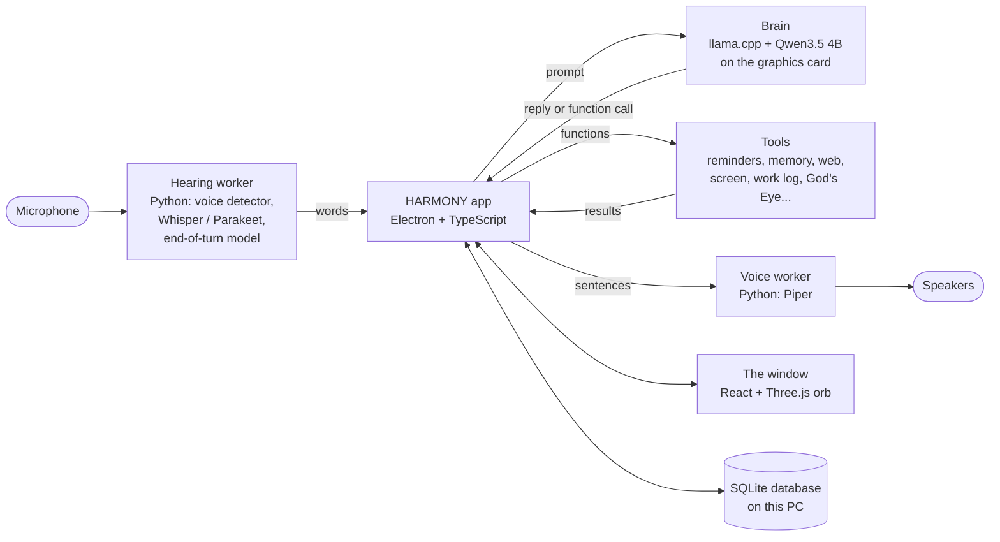
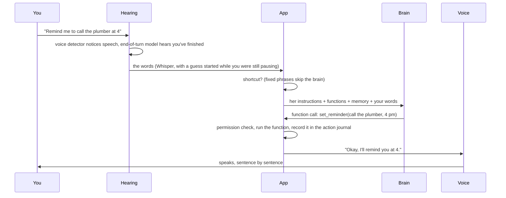

# How HARMONY works

HARMONY is a personal assistant that lives on one Windows PC. You talk to her, she answers out loud, and she can
set reminders, look things up, read your screen, keep a work log, show a live 3D globe of world events and more.
Her hearing, brain and voice all run on the PC itself. The internet is used only for things that need it (weather,
news, searches, live world data), and only when asked.

This page explains the moving parts in plain words, from "you say something" to "she answers", then each part on its
own. File names are given so you can find the code.

- [The big picture](#the-big-picture)
- [What happens when you talk to her](#what-happens-when-you-talk-to-her)
- [The parts](#the-parts)
- [What leaves the PC](#what-leaves-the-pc)
- [How she's checked](#how-shes-checked)
- [Where things live](#where-things-live)

## The big picture

Three kinds of program work together:

- **The app** (Electron, written in TypeScript) is the conductor. It owns the database, decides what happens next,
  checks permissions and draws the window. Code: `apps/desktop` (window) and `core` (everything else).
- **Workers** are small Python programs the app starts and talks to over a private pipe: hearing, voice, the guard
  (voice and face checks), desktop control, memory search and a few others. Code: `workers`. Each one is started
  with fixed arguments, and the app checks its answers, so a worker can't be told to do something new.
- **The brain** is `llama-server` from the llama.cpp project, running the Qwen3.5 4B model on the graphics card. The
  app talks to it on a private address with a random key that changes every time it starts. Code: `core/local-model.ts`.

## What happens when you talk to her

1. **Listening.** The microphone streams 32 ms slices of sound to the hearing worker (`workers/speech/worker.py`).
   A small voice detector (Silero) says which slices contain speech. Nothing is recorded to disk.
2. **Knowing you've finished.** When you pause, a tiny end-of-turn model (Smart Turn, `workers/speech/smart_turn.py`)
   listens to how the sentence ended. "Finished" ends your turn at 0.32 s; "not finished" (a mid-sentence "um...")
   waits up to a second for you to go on.
3. **Turning sound into words.** Whisper (and the faster Parakeet model once it has loaded) transcribes the turn.
   To save time, a guess starts while you're still pausing; if you really have finished, that guess is used.
4. **Shortcuts.** Some requests have a fixed meaning ("status", "where was I", "when's the next bus") and are handled
   at once without the brain (`shortcut()` in `core/assistant-actions.ts`).
5. **The brain.** Everything else goes to the brain as one prompt: her instructions, the list of functions she may
   call, what you've asked her to remember, the conversation so far, the time, and your words. The start of that
   prompt is the same every time, so it is read into the brain's memory ahead of time (`warm()` in
   `packages/reasoning/local-chat.ts`); each request then reads only its own new words.
6. **Functions.** If the brain answers with a function call (`set_reminder`, `get_weather`, `work_log`...), the app
   checks it against the permission policy, runs it through the tool dispatcher, records it in the action journal and,
   where possible, can undo it (`core/tool-dispatcher.ts`, `core/action-journal.ts`). Lookups (weather, web, email,
   screen) get a second brain pass that turns the results into a spoken answer; that pass cannot run actions.
7. **Speaking.** The reply is cut into sentences as it streams out of the brain, and each sentence goes to the voice
   worker (Piper, `workers/voice`) straight away, so she starts talking before the whole answer exists.
8. **Interrupting.** While she talks, a keyword listener (Vosk) waits for "Harmony" or "stop". Either one cuts her off
   and keeps whatever you say next.

Measured on the development PC (GTX 1650 with 4 GB, 4-thread CPU): launch to fully ready in 10-15 s; the brain's
choice of function and arguments takes about 1.6 s once warm (`Check brain.cmd`); 49 of 52 everyday requests handled
exactly as expected, and none of the other 3 unsafe.

## The parts

### Hearing (`workers/speech`)
Silero voice detection; Whisper base.en for the first seconds after launch, then NVIDIA Parakeet (more accurate) once
it has loaded in the background; Smart Turn for end of turn; Vosk for the wake word and "stop". The wake word can come
anywhere in a sentence: "What's the weather, Harmony?" works. All models are pinned by SHA-256 in `docs/*.json` and
checked before use.

### Brain (`core/local-model.ts`, `packages/reasoning`)
llama.cpp's server with Qwen3.5 4B (4-bit), all layers on the GPU, 8,192 tokens of context. It is started when needed
and unloaded after 45 minutes idle. "Thinking" mode is off, because it delays the first spoken word. The prompt format
is written out exactly (`qwenChatPrompt`) so each turn extends the last one and the cache is reused.

### Voice (`workers/voice`)
Piper text-to-speech with an Australian female voice trained for HARMONY (Alba, a Scottish voice, if that isn't
installed). Speech is made sentence by sentence while the brain is still writing.

### Actions and safety rails (`core/tool-dispatcher.ts`, `packages/permissions`, `core/action-journal.ts`)
Every function is a registered tool with a typed input, a risk level (read-only, low-risk write...) and a permission
it needs. The dispatcher checks the policy, runs it, verifies the result, and records each step so an interrupted
action is never silently retried and a finished one can be undone.

### Memory (`core/memory.ts`, `core/recall.ts`, `core/embedder.ts`)
She remembers things **only when asked** ("remember that..."). Recall searches those memories, project notes and (if
you turn it on) past conversations, by meaning (a small local embedding model) and by words. Secrets are masked
before anything is saved (`core/redact.ts`).

### The guardian (`core/guardian.ts`, `workers/guard`, `core/owner-verification.ts`)
Who is talking and who is at the PC: a voice print of each request and, if turned on, a face print with a liveness
check, kept in an encrypted vault. Risky actions need the owner; when the owner is away, HARMONY locks. Monthly
security drills attack her on purpose (replayed audio, a photo held to the camera, hostile text in web pages and email)
in a sandbox and report what held (`core/security-drills.ts`).

### Looking things up (`core/web.ts`, `core/world-feeds.ts`, `core/metro.ts`)
Free sources without accounts: Open-Meteo weather, Google News RSS, Wikipedia, DuckDuckGo/Mojeek search, and public
world feeds (USGS and EMSC earthquakes, NWS alerts, GDACS disasters, NASA EONET, NOAA space weather and aurora,
hurricanes, wildfires, river gauges, FAA airport status, CISA exploited vulnerabilities, internet outages), plus
Madison Metro bus arrivals. Everything fetched is treated as untrusted text: trimmed, labelled with its source, and
never allowed to give her orders.

### God's Eye (`core/gods-eye.ts`, `overlays/gods-eye`)
A live 3D globe (God's Eye View, MIT licence) in its own window: flights, ships, satellites, quakes, cameras, GPS
jamming. HARMONY installs it from a pinned version and lays her own improvements over it, each file checked against the
exact original (`core/gods-eye-overlay.ts`). She can open it, fly to places, run ambient and replay modes, and answer
questions from its data.

### Being proactive without being annoying (`core/interruptions.ts`)
Reminders, watch-zone alerts ("watch Madison"), the morning brief, Wi-Fi drops and new devices on the network all
become events that are scored, then shown, spoken later, spoken now, or dropped, respecting focus mode, ghost mode
and quiet hours.

### Your PC (`core/desktop.ts`, `workers/desktop/desktop.ps1`)
Open apps and sites, switch windows, media and volume keys, and read the window you're looking at (text recognition).
Everything goes through one fixed PowerShell script that accepts only a short list of commands. Hand signs through the
camera can stop her or answer an approval (`core/gestures.ts`).

### Overnight work: Spiral Time (`core/spiral-time.ts`)
Research you saved "for Spiral Time", plus standing checks (security news, newer models, remote job leads), is written
as a ticket into the `handoff` folder for Claude to do overnight; the results come back into HARMONY's inbox. Secrets
are masked in the ticket.

### Keeping herself healthy
One-click updates that build beside the running version and can be rolled back (`core/updater.ts`); daily backups and
optional encrypted off-PC copies (`core/backup.ts`, `core/offsite-backup.ts`); offline mode that queues web questions
(`core/connectivity.ts`); Wi-Fi reconnect (`core/wifi-reconnect.ts`); a speed scoreboard and startup timeline
(`core/speed-scoreboard.ts`, `.runtime/startup.json`); self-checks on request.

## What leaves the PC

| What | Where to | When |
|---|---|---|
| Search words, news topics, place names | DuckDuckGo/Mojeek, Google News, Open-Meteo, Wikipedia | Only when you ask something that needs it; secrets masked first |
| Requests for public feeds | USGS, NOAA, NASA, GDACS, CISA, Madison Metro and others | When you ask, watch an area or open God's Eye; nothing about you is in them |
| Gmail and Calendar reads | Google, with your sign-in | Only if you connect them; read-only, she can't send |
| Spiral Time tickets | The local `handoff` folder, for Claude | When you start Spiral Time; secrets masked |
| Your voice, face, memories, conversations, work log | Nowhere | Never |

## How she's checked

- `npm test`: about 660 automated tests of the code, with stand-in hearing, voice and brain.
- `npm run typecheck` and `npm run build`.
- `Check brain.cmd`: 52 everyday requests through the **real** brain and prompt on your PC, scored for the right
  function and sensible details (`evals/brain-cases.ts`, results in `.runtime/brain-check.txt`).
- `Check security.cmd`: the security drills. `Check God's Eye.cmd` and `Check Wi-Fi.cmd` check those parts.

## Where things live

| Folder | What's in it |
|---|---|
| `apps/desktop` | The window (React), the Electron main process and the bridge between them |
| `core` | HARMONY's logic: conversation, tools, memory, guardian, lookups, God's Eye, updates |
| `packages` | Shared pieces: the brain client, permissions, tool registry, contracts |
| `workers` | The Python helpers: hearing, voice, guard, desktop control, memory search |
| `overlays/gods-eye` | HARMONY's changes to God's Eye View, applied over the pinned original |
| `evals` | The real-brain test cases |
| `tests` | Automated tests |
| `docs` | Design notes, decisions, model pins and licences |
| `data` (not in git) | Your database, models, settings and vault |
| `.runtime` (not in git) | The brain engine, logs, timings and probe results |
